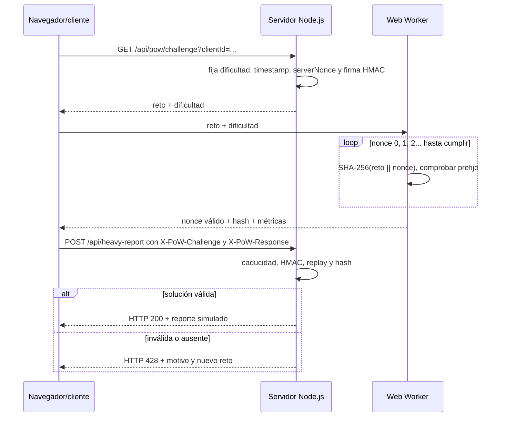

# Informe del proyecto Proof of Work blockchain y consenso

## 1. Resumen ejecutivo

Este repositorio contiene dos demostraciones académicas relacionadas con Proof of Work. La original es un control de acceso para una API costosa basado en Hashcash. Se añadió además una blockchain local con transacciones Ed25519, Merkle root y bloques enlazados, junto con minado paralelo de nonce con Dask y una simulación independiente del algoritmo bizantino OM(m). Encontrar el nonce exige probar candidatos; verificar una solución es barato.

El sistema también ofrece un panel con métricas, un ajuste de dificultad que sube según el tráfico medido, simulaciones didácticas, y un benchmark independiente en Python que exporta CSV/JSON y una gráfica.

**Alcance real:** son prototipos académicos locales, no una criptomoneda ni una red P2P de blockchain, y tampoco son un rate limiter de producción ni una defensa completa contra DDoS. El PoW del endpoint regula el coste de acceso; la extensión blockchain muestra encadenamiento y elección local por trabajo acumulado; el benchmark Dask mide paralelismo entre procesos. OM(m) se simula aparte y no se usa para validar bloques.

## 2. Qué problema intenta resolver

Una API puede recibir muchas llamadas que consumen CPU, base de datos u otros recursos. En un control tradicional, el servidor debe decidir si cada petición puede continuar. La idea del PoW es trasladar parte del coste al solicitante:

1. El servidor entrega un desafío único y fija la dificultad.
2. El cliente hace trabajo computacional hasta hallar una respuesta válida.
3. El servidor vuelve a calcular un hash para comprobar esa respuesta.
4. Si es válida y no se ha usado antes, procesa la operación protegida.

Un usuario legítimo hace el trabajo una vez por solicitud autorizada; un emisor masivo debe pagar ese coste para cada intento exitoso. La técnica aumenta el coste del abuso, pero no identifica por sí sola a una persona ni impide que un atacante con muchos equipos siga enviando tráfico.

## 3. Arquitectura y archivos

| Archivo | Función | Cómo participa |
|---|---|---|
| `server.js` | Servidor HTTP, emisión/verificación de retos, métricas, dificultad, archivos estáticos y ejecución de benchmark | Es el punto de entrada de `npm start`; escucha normalmente en el puerto 3000. |
| `public/index.html` | Estructura y estilos del dashboard | Presenta controles, contadores, gráficas, terminales y estado de PoW. |
| `public/app.js` | Controlador del navegador | Llama a las API, inicia el Web Worker, actualiza el panel y activa las simulaciones. |
| `public/pow-worker.js` | Búsqueda PoW en segundo plano | Prueba nonces con Web Crypto para que el cálculo no congele la interfaz. |
| `pow_crypto.py` | Implementación Python de Hashcash simplificado y funciones auxiliares | Incluye generación de reto, minado, verificación y cálculo de razón de esfuerzo. |
| `run_benchmark.py` | Mediciones repetidas del minado/verificación Python | Produce los resultados JSON y CSV para varios niveles de dificultad. |
| `plot_benchmark.py` | Gráfica con Matplotlib | Lee el JSON y guarda PNG en la raíz y en `public/`. |
| `test_e2e.js` | Prueba HTTP de flujo en Node.js | Pide reto, lo resuelve, llama al endpoint y prueba replay. |
| `test_e2e.py` | Prueba de cliente Python contra servidor Node.js | Usa el solver Python para resolver un reto del servidor. |
| `pow_benchmark_results.csv/json` | Resultados del benchmark guardados | Datos de entrada para visualizar y analizar el coste. |
| `pow_benchmark_activity.json` | Muestra de actividad capturada durante una ejecución del benchmark desde el panel | Registra tráfico y dificultad observados durante ese intervalo. |
| `package.json` | Metadatos, dependencias y comandos | Define `start`, `benchmark` y `test`. |

### Por qué combinar JavaScript y Python

Node.js atiende la web y el protocolo HTTP; el navegador puede minar con Web Crypto. Python se utiliza como entorno separado para medir el coste del algoritmo y crear la gráfica con Matplotlib. No hay una llamada de Python por cada petición: el servidor verifica PoW directamente en JavaScript. Python se ejecuta en el benchmark y en su prueba E2E.

## 4. Algoritmo PoW explicado para la exposición

### 4.1 Hash SHA-256

SHA-256 recibe datos de longitud variable y produce una huella de 256 bits, que suele mostrarse como 64 caracteres hexadecimales. Un cambio pequeño en la entrada normalmente produce una huella que parece impredecible. En este proyecto se calcula:

`hash = SHA256(challenge || nonce)`

`||` significa concatenar. Por ejemplo, si el reto fuera `abc` y el nonce `123`, se calcularía SHA-256 de los bytes de `abc123`.

El hash no se “descifra” para encontrar el nonce. Se prueban candidatos: 0, 1, 2, 3… hasta que alguno cumple la condición.

### 4.2 Condición de éxito y probabilidad

En el servidor web y el Web Worker, la dificultad `d` está expresada como cantidad de **nibbles hexadecimales iniciales en cero**: `hash.startsWith('0'.repeat(d))`. Cada dígito hexadecimal representa 4 bits. Por ello:

- 4 ceros hex = 16 bits iniciales en cero.
- 5 ceros hex = 20 bits.
- 6 ceros hex = 24 bits.

Con `k` bits de ceros, la probabilidad de que un hash aleatorio sea válido es `1 / 2^k`. El número esperado de intentos es `2^k`. No es una garantía: a veces se encuentra antes y a veces después. Agregar un bit duplica el trabajo esperado; agregar cuatro bits (un cero hex) lo multiplica por 16.

| Dificultad del servidor | Bits equivalentes | Intentos esperados aproximados |
|---:|---:|---:|
| 4 ceros hex | 16 | 65 536 |
| 5 ceros hex | 20 | 1 048 576 |
| 6 ceros hex | 24 | 16 777 216 |

El texto del dashboard muestra estimaciones de tiempo (“~0.05s”, “~1.0s”, “~15-30s”), pero son orientativas, dependen del dispositivo y no se deducen de forma universal de la dificultad.

### 4.3 Coste asimétrico

- **Resolver:** búsqueda iterativa, con coste esperado exponencial respecto a los bits de dificultad: `O(2^k)` hashes.
- **Verificar:** calcular un solo SHA-256 y revisar sus primeros bits: `O(1)` hashes (la comprobación del prefijo es acotada porque SHA-256 siempre tiene 256 bits).

Esta asimetría es el argumento central de Hashcash: encontrar es comparativamente caro; verificar es barato. “O(1)” aquí compara la cantidad de hashes requeridos para validar una solución individual; no quiere decir que el servidor no consuma CPU, ni que la verificación tarde literalmente cero.

### 4.4 Nonce

El nonce es el número variable que el cliente modifica en cada intento. No es una contraseña secreta. Sirve para generar distintas entradas al hash hasta que una cumpla el objetivo. En este código el nonce recorre enteros desde 0 y se representa como texto decimal.

### 4.5 Reto y firma HMAC

El servidor construye el texto:

`timestamp:clientId:difficulty:serverNonce:hmac`

La firma se calcula como HMAC-SHA-256 sobre los primeros cuatro campos, usando una clave secreta aleatoria del proceso. HMAC permite detectar si alguien alteró el reto: por ejemplo, subir la dificultad declarada, cambiar el cliente o sustituir el nonce aleatorio. HMAC **no cifra** el reto; cualquiera que lo recibe puede leerlo.

El `serverNonce` aporta aleatoriedad para que los retos no sean idénticos. El timestamp permite caducidad. El HMAC autentica el contenido. Son mecanismos distintos con objetivos distintos.

### 4.6 Prevención de repetición (replay)

Al verificar una solución válida, el servidor registra la combinación de firma del reto y nonce del cliente en un `Set`. Si llega otra vez la misma combinación, la rechaza. Por eso reutilizar exactamente una prueba aceptada no da acceso otra vez. Una solución nueva para el mismo reto puede ser aceptable si nadie la usó: la clave de repetición es combinación reto-firma más nonce, no solo el reto.

## 5. Flujo completo de una solicitud



### Paso a paso en el código

1. `GET /api/pow/challenge`: `PoWEngine.generateChallenge()` elige dificultad según el tráfico (o modo manual), genera timestamp y aleatoriedad, firma los campos y devuelve el reto.
2. `public/app.js`: al pulsar “Seguro”, pide el reto y crea `Worker('pow-worker.js')`.
3. `public/pow-worker.js`: genera lotes de 64 candidatos con `crypto.subtle.digest('SHA-256', ...)`, comprueba en orden el prefijo y envía mensajes `PROGRESS` periódicos o `SUCCESS`.
4. El navegador envía el reto y nonce en `X-PoW-Challenge` y `X-PoW-Response` a `POST /api/heavy-report`.
5. `PoWEngine.verify()` rechaza campos ausentes, formato incorrecto, reto vencido, HMAC incorrecto, replay o hash que no cumpla la dificultad.
6. Si valida, el servidor incrementa el contador, registra el evento y simula trabajo de reporte con un retardo de 40 ms; responde con datos ficticios y métricas. No está consultando una base de datos real.

## 6. Control adaptativo de dificultad

`TrafficManager` conserva marcas de tiempo de peticiones recientes y calcula RPS usando la ventana de los últimos diez segundos. En modo automático:

- menos de 5 req/s: 4 ceros hex (16 bits);
- desde 5 y menos de 15 req/s: 5 ceros (20 bits);
- 15 req/s o más: 6 ceros (24 bits).

La intención es elevar el coste del acceso cuando sube la carga. Hay selector manual en la interfaz que llama a `POST /api/admin/difficulty`; enviar `auto` devuelve el comportamiento a la selección automática.

**Detalle importante para describir con precisión:** todas las rutas que pasan por el manejador principal llaman a `recordRequest()`, incluidas las llamadas de métricas del propio dashboard, peticiones de reto, archivos y preflight CORS. Por tanto, el RPS no representa necesariamente solo intentos contra el endpoint protegido. El cálculo divide la cantidad de eventos de los últimos diez segundos entre 10 incluso durante el arranque, lo que suaviza/subestima el tráfico reciente antes de que la ventana se llene.

## 7. Dashboard y simulaciones

El HTML presenta el panel; `app.js` consulta `/api/metrics` cada segundo y actualiza RPS, dificultad, contadores, registros y gráfica. Incluye:

- **Sin PoW:** manda una solicitud sin las cabeceras y permite observar el HTTP 428.
- **Seguro (Web Worker):** resuelve un reto real del servidor y envía la solución.
- **Replay:** vuelve a enviar el último reto/nonce aceptado para demostrar que se bloquea su reutilización.
- **Simulaciones nopow/masivo/mixto:** generan ráfagas de solicitudes desde el navegador. Son demostraciones locales y deben detenerse con el botón correspondiente.
- **Dificultad:** cambia el nivel manualmente o restaura `auto`.
- **Benchmark:** solicita al servidor que ejecute los scripts Python y muestra resultados/gráfica.

El indicador “CPU ahorrado” no es una medición directa de CPU: se calcula como porcentaje de rechazos multiplicado por una constante fija de 98.5. Úsalo como indicador ilustrativo de la interfaz, no como resultado experimental.

## 8. Algoritmo Python y benchmark

`pow_crypto.py` implementa el prefijo en **bits**, no en cantidad de ceros hex. Separa `k` en bytes enteros (`k // 8`) y bits restantes (`k % 8`), exige que los bytes completos sean cero y usa una máscara para verificar los bits iniciales restantes. Así puede representar, por ejemplo, una dificultad de 14 bits aunque no equivalga a un número entero de ceros hex.

`solve_pow()` prueba nonces secuenciales y devuelve nonce, cantidad probada, tiempo y hash. `verify_pow()` calcula una sola huella y revisa esos bits. `generate_pow_challenge()` firma retos para el entorno Python con una clave fija propia del benchmark. El benchmark no valida esa firma: su propósito es medir la búsqueda/verificación matemática.

`run_benchmark.py` mide 12, 14, 16, 18, 20 y 22 bits; realiza cinco muestras por nivel y calcula promedios de tiempo, hashes, tasa de hashes y cociente entre tiempo del cliente y tiempo de verificación. Escribe CSV/JSON. `plot_benchmark.py` representa tiempo del cliente, tiempo del servidor y cociente en escalas logarítmicas.

### Diferencia crítica entre implementaciones

El servidor y Web Worker interpretan `difficulty` como **ceros hex completos**. El benchmark Python utiliza bits arbitrarios. Para 12, 14, 18 y 22 bits, `hexZeros = bits // 4` solo conserva el entero inferior. Por ejemplo, el benchmark de 14 bits crea un reto que declara 3 ceros hex (12 bits), pero `solve_pow(..., 14)` busca 14 bits. La firma Python se genera, pero el solver no verifica la firma ni exige que la dificultad declarada coincida con sus bits. Para 16 y 20 bits sí hay correspondencia exacta (4 y 5 ceros). Por ello, los resultados de Python describen el algoritmo por bits y no deben presentarse como una medición directa de cada nivel del servidor.

También hay que tener cuidado con el nombre “asymmetry ratio”: es el promedio de tiempo de minado dividido por el promedio del tiempo de una verificación Python en esa máquina, y puede variar mucho con hardware, carga, temporizadores y ruido de medición. No es una constante criptográfica universal ni una garantía de protección.

## 9. Cómo leer los archivos de resultados

En el CSV/JSON:

- `Bits`: bits cero requeridos por el solver Python.
- `HexZeros`: valor entero `bits // 4` usado en el campo difficulty del reto generado.
- `ExpectedHashes`: `2^bits`, intentos medios teóricos.
- `AvgHashesTested`: promedio observado de candidatos probados.
- `ClientTimeMs`: tiempo medio del solver Python.
- `ServerTimeMs`: tiempo de una verificación Python.
- `HashRate`: tasa aproximada de hashes/segundo durante minado.
- `AsymmetryRatio`: cociente redondeado de tiempos.

Los resultados guardados son una ejecución anterior y dependen de la máquina que la produjo. Para una exposición, conviene ejecutar el benchmark en el equipo que se mostrará y explicar que hay variación estadística. No comparar directamente tiempos Python, Node y Web Crypto como si fueran el mismo entorno de ejecución.

## 10. Pruebas incluidas

`test_e2e.js` pide un reto al servidor, mina usando `crypto` de Node, llama al endpoint y después reutiliza la misma prueba para observar el rechazo de replay. `test_e2e.py` pide un reto al servidor, lo resuelve con Python y envía la solución. Ambos requieren que el servidor esté activo en localhost:3000.

El comando `npm test` corre primero la prueba Node y luego Python. Son pruebas de integración HTTP, no una suite completa de seguridad o carga. El archivo Python informa el fallo HTTP, pero no necesariamente termina con código de error si la petición se rechaza.

## 11. Límites técnicos y puntos a no sobreafirmar

1. **No es un limitador por tasa real:** no hay buckets por IP/usuario, cuotas, cola, bloqueo de conexiones ni control del ancho de banda. El endpoint protegido exige PoW, pero otras rutas siguen expuestas.
2. **El autotuning es global y en memoria:** todos los clientes comparten dificultad; se pierde al reiniciar. No es persistente ni distribuido.
3. **La clave HMAC cambia al arrancar:** `SECRET_KEY` se genera aleatoriamente al iniciar el proceso. Los retos previos al reinicio dejan de poder verificarse, lo cual es aceptable en una demo, pero no constituye gestión de claves persistente.
4. **El almacén anti-replay no está acotado:** `usedSignatures` crece en memoria indefinidamente y se reinicia con el proceso. En producción necesitaría expiración/limpieza y almacenamiento apropiado.
5. **Validaciones faltantes de parámetros:** la ruta administrativa no restringe la dificultad a un rango ni autentica al administrador; cualquiera que pueda acceder a la ruta puede modificarla. La verificación tampoco establece un rango explícito para dificultad. El endpoint admin es de demostración.
6. **No hay limitación antes del reto:** se puede solicitar `/api/pow/challenge` repetidamente; el trabajo de generar reto es pequeño. Para ataques de red volumétricos hacen falta controles de infraestructura y de conexión.
7. **Caducidad:** se rechaza si `ahora - timestamp > 60s`, pero la implementación no rechaza explícitamente timestamps futuros.
8. **CORS abierto:** se permite `*`, adecuado para demo sencilla; debe revisarse en un despliegue real.
9. **Métricas aproximadas:** la ventana RPS mezcla rutas; “CPU ahorrado” es una fórmula visual; el reporte protegido es simulado.
10. **Escala del reto:** la dificultad sube en saltos de 4 bits. De 4 a 5 ceros se multiplica por 16 el trabajo esperado; de 5 a 6, otra vez por 16. Un dispositivo lento puede sufrir una penalización alta.

Para un despliegue real: restringir/authenticar administración, validar y acotar dificultad, usar límites de tasa convencionales, proteger la emisión del reto, fijar/rotar claves de forma gestionada, poner expiración y límite al anti-replay, medir CPU de verdad, aplicar TLS, observabilidad y pruebas de carga y abuso.

## 12. Guion oral sugerido (5–7 minutos)

1. **Problema:** “Una API costosa puede ser saturada con muchas peticiones. Queremos hacer que cada acceso legítimo tenga un pequeño costo computacional.”
2. **Idea del PoW:** “El servidor publica un reto; el cliente busca un nonce cuyo SHA-256 empiece con ceros. No existe un atajo útil: se prueban candidatos.”
3. **Por qué funciona:** “Con k bits requeridos, la probabilidad por intento es 1/2^k y el promedio son 2^k. Encontrar es trabajo repetitivo; verificar es un hash.”
4. **Recorrido de la demo:** mostrar el botón sin PoW (428), luego el botón seguro (worker busca y el servidor da 200), y finalmente replay (428 por reutilización).
5. **Arquitectura:** “Node lleva HTTP y verifica; el navegador mina en Web Worker para no bloquear la interfaz; Python mide la versión de laboratorio y Matplotlib dibuja resultados.”
6. **Control de dificultad:** explicar umbrales por RPS y aclarar que son globales y orientativos.
7. **Cierre honesto:** “Es una demostración académica del PoW como barrera de coste. Por sí sola no detiene un DDoS volumétrico y el benchmark Python no es exactamente el mismo perfil del servidor.”

### Frase de una oración

> El proyecto protege un endpoint costoso exigiendo que el cliente encuentre, mediante búsqueda por fuerza bruta, un nonce cuyo SHA-256 cumpla una dificultad; el servidor verifica la respuesta en un hash y evita reutilizar la misma prueba.

### Preguntas que podrían hacer en clase

- **¿El PoW cifra la petición?** No. El hash y HMAC no cifran el contenido; TLS se ocupa de confidencialidad en tránsito.
- **¿Por qué el servidor no mina?** El servidor define el reto y comprueba la solución; que el cliente haga la búsqueda desplaza el coste.
- **¿Por qué aumenta exponencialmente?** Cada bit adicional reduce a la mitad la probabilidad de éxito por intento, duplicando el número esperado.
- **¿Siempre se prueban `2^k` hashes?** No, es el promedio probabilístico; una búsqueda concreta puede terminar antes o después.
- **¿Qué evita replay?** Registrar y rechazar la misma pareja reto-firma/nonce que ya fue aceptada.
- **¿Esto impide un DDoS?** No por completo. Puede encarecer solicitudes exitosas, pero no evita saturar enlaces ni abusar de rutas sin protección.
- **¿Qué hace HMAC?** Permite al servidor detectar cambios en los campos del reto usando una clave que el cliente no conoce.

## 13. Ejecución del proyecto

- Servidor y dashboard: `npm start` y abrir `http://localhost:3000`.
- Benchmark más gráfica: `npm run benchmark`.
- Pruebas de integración: con el servidor activo, `npm test`.

Dependencias declaradas en `package.json`: Express y CORS, aunque el servidor actual usa módulos HTTP nativos (`http`, `crypto`, `fs`, etc.) y no importa Express/CORS. Python requiere Matplotlib para generar la gráfica.

## 14. SHA-256 con un poco más de profundidad

SHA-256 pertenece a la familia SHA-2 y siempre produce una salida de 256 bits, sin importar si la entrada es corta o larga. En hexadecimal se representa con 64 caracteres. Por ejemplo, los 256 bits se agrupan en 32 bytes y cada byte se escribe con dos dígitos hexadecimales.

A grandes rasgos, el algoritmo prepara la entrada, la divide en bloques de 512 bits y procesa cada bloque mediante operaciones sobre palabras de 32 bits. Incluye sumas modulares, desplazamientos, rotaciones y funciones booleanas, repetidas en 64 rondas por bloque. Al final combina el estado interno para producir el resumen de 256 bits. La implementación concreta la proporciona la biblioteca criptográfica del lenguaje (`crypto` en Node/Web Crypto y `hashlib` en Python); el proyecto no reimplementa a mano las rondas de SHA-256.

La propiedad relevante para PoW es que pequeñas variaciones en la entrada producen salidas que aparentan ser aleatorias. Cambiar el nonce de `81` a `82` no cambia la salida de forma gradual: cambia la huella completa de manera impredecible. Esto permite tratar cada intento como una nueva oportunidad de acertar el prefijo.

Un detalle de complejidad: decir que verificar cuesta O(1) se refiere al número de hashes: un hash por candidato recibido. SHA-256 procesa bloques de 512 bits; si la entrada creciera arbitrariamente, el tiempo sería proporcional a su longitud. En esta aplicación el tamaño del reto es pequeño y acotado, así que cada comprobación se considera de coste constante respecto de la dificultad PoW.

## 15. Probabilidad, dificultad y tiempo de búsqueda

Supongamos que se exige un prefijo de `k` bits cero. Si SHA-256 se comporta como una función aleatoria, hay `2^256` salidas posibles y `2^(256-k)` cumplen el prefijo. Por lo tanto:

`P(éxito por intento) = 2^(256-k) / 2^256 = 1 / 2^k`

Cada intento es aproximadamente independiente. El número de intentos hasta el primer éxito sigue una distribución geométrica: la media es `1/p = 2^k`, pero no significa que la búsqueda tarde exactamente ese número. En promedio, la mitad de las búsquedas habrá terminado tras aproximadamente `0.693 × 2^k` pruebas; algunas terminan en la primera prueba y otras tardan mucho más.

Si el equipo prueba `H` hashes por segundo, el tiempo promedio teórico es aproximadamente `2^k / H` segundos. Por ejemplo, a 250 000 hashes/s, una dificultad de 16 bits daría `65 536 / 250 000 ≈ 0.26 s` en promedio. Este cálculo ayuda a comparar niveles, pero el tiempo real cambia con el procesador, el navegador, la temperatura, el consumo eléctrico, la carga de otras tareas y la implementación SHA utilizada.

En la versión del servidor, subir de 4 a 5 ceros hex agrega cuatro bits y multiplica por 16 el número esperado de intentos. Subir de 5 a 6 vuelve a multiplicar por 16. Por esa razón, cambios visualmente pequeños en la dificultad pueden generar diferencias grandes en el tiempo del usuario.

## 16. Cómo se construyen y validan los retos

### 16.1 Emisión del reto

`PoWEngine.generateChallenge()` realiza estas operaciones:

1. Toma el tiempo actual en milisegundos.
2. Convierte el `clientId` a texto y reemplaza `:` por `_` para no romper el formato separado por dos puntos.
3. Obtiene el nivel de dificultad actual del gestor de tráfico.
4. Genera 8 bytes aleatorios con `crypto.randomBytes(8)` y los expresa como 16 caracteres hexadecimales.
5. Une timestamp, identificador, dificultad y aleatoriedad para formar el `payload`.
6. Calcula HMAC-SHA-256 del payload con la clave secreta del proceso.
7. Devuelve el reto completo, la dificultad y el plazo de 60 segundos.

El plazo se informa en la respuesta y el servidor aplica 60 segundos en la validación. El cliente no decide la dificultad: la recibe del servidor y la solución queda atada a ese texto firmado.

### 16.2 Validación en el endpoint

`PoWEngine.verify()` valida en este orden: que existan reto y nonce, que el reto se pueda dividir en cinco campos, que timestamp y dificultad sean números, que no hayan pasado más de 60 segundos, que el HMAC sea correcto, que la pareja de uso no haya aparecido antes y, finalmente, que SHA-256(reto + nonce) tenga el prefijo exigido.

La comprobación HMAC se hace antes de aceptar el resultado matemático. Así, un usuario no puede cambiar la dificultad dentro del reto y conservar una firma válida. La comparación usa `timingSafeEqual` para evitar una comparación corriente carácter por carácter cuya duración pudiera revelar información parcial de la firma.

La verificación del prefijo en Node usa caracteres hexadecimales: construye una cadena de `d` ceros y usa `startsWith`. El Web Worker examina bytes directamente: por cada cero hex completo exige un byte `0x00`; si el número de ceros hex es impar, además exige que los cuatro bits altos del siguiente byte sean cero. Son dos representaciones equivalentes de la misma condición.

### 16.3 Qué protege cada campo

| Campo | Propósito | Lo que no hace |
|---|---|---|
| `timestamp` | Limita la vida útil del reto | No cifra el reto ni impide por sí solo la repetición dentro de la ventana. |
| `clientId` | Etiqueta a qué cliente se emitió el reto | No autentica la identidad; el cliente puede elegir el texto del identificador. |
| `difficulty` | Determina el trabajo que se exige | No controla el tiempo exacto en cada dispositivo. |
| `serverNonce` | Hace único/aleatorio cada reto | No es la respuesta PoW del cliente. |
| `hmac` | Detecta alteraciones de los campos firmados | No cifra ni oculta los campos. |
| nonce del cliente | Hace variar el hash hasta cumplir el objetivo | No es secreto y no prueba quién hizo el cálculo. |

## 17. Endpoints y códigos HTTP

| Ruta | Método | Uso | Resultado habitual |
|---|---|---|---|
| `/api/pow/challenge` | GET | Emitir reto para un cliente | `200` con reto, dificultad y expiración. |
| `/api/heavy-report` | POST | Solicitar el reporte protegido | `200` con reporte simulado si el PoW es válido; `428` si falta o falla. |
| `/api/metrics` | GET | Leer métricas y series temporales del dashboard | `200` con RPS, dificultad, contadores, logs y uptime. |
| `/api/admin/difficulty` | POST | Forzar dificultad o seleccionar `auto` | `200` con el nuevo nivel; `400` si el JSON no es válido. |
| `/api/benchmark/run` | POST | Ejecutar benchmark Python y producir gráfica | `200` con los resultados si ambos scripts terminan; `500` ante fallo de ejecución. |
| `/api/benchmark/activity` | GET | Leer la última captura de actividad del benchmark | `200` con JSON o `404` si no hay captura. |
| `/api/benchmark/csv` | GET | Descargar los resultados tabulares | `200` con CSV o `404` si no está disponible. |

HTTP 428 significa “Precondition Required”: el servidor requiere una condición previa antes de procesar la solicitud. El proyecto lo usa para comunicar que el PoW falta o no fue aceptado. Para una respuesta rechazada incluye el motivo y un siguiente reto en el cuerpo JSON.

El servidor también responde a `OPTIONS` con `204` para permitir las solicitudes CORS de preflight. Las cabeceras aceptadas incluyen `X-PoW-Challenge`, `X-PoW-Response` y `X-Client-ID`.

## 18. Cómo trabaja el minero del navegador

El hilo principal del navegador debe seguir respondiendo a clics y dibujar la interfaz. Si buscara nonce en un bucle síncrono, el panel se congelaría mientras calcula. El proyecto crea un Web Worker, que tiene un contexto de ejecución separado y puede hacer la búsqueda sin bloquear el hilo visual.

El worker recibe el reto y la dificultad, valida que el número de ceros hex esté entre 1 y 64 y prepara un `TextEncoder`. En cada ciclo:

1. Reserva 64 nonces consecutivos.
2. Codifica reto más nonce como bytes UTF-8.
3. solicita SHA-256 mediante `crypto.subtle.digest` para los 64 candidatos.
4. Revisa las respuestas en orden y selecciona el primer nonce válido del lote.
5. Si aún no hay respuesta, avanza al siguiente lote y cede el control con `setTimeout(..., 0)`.
6. Aproximadamente cada 100 ms informa hashes probados, tasa aproximada y tiempo transcurrido.

Calcular por lotes reduce la sobrecarga de gestionar cada candidato individualmente y permite mostrar progreso. Como el lote se calcula en paralelo pero se revisa en orden, el resultado se presenta como el primero válido dentro del lote; no necesariamente implica que ningún nonce posterior ya se haya calculado cuando se detecta el éxito.

El worker produce `SUCCESS`, `PROGRESS` o `ERROR`. `app.js` traduce estos mensajes a números y logs del panel. Después de `SUCCESS` envía el nonce al servidor, pero es el servidor quien recalcula el hash; no confía en el hash ni en las métricas enviados por el navegador.

## 19. Benchmark: metodología y lectura de los resultados existentes

El benchmark resuelve cinco retos independientes por cada dificultad y calcula promedios. Los retos distintos evitan que las muestras sean simplemente la reutilización de una misma solución. La cantidad de hashes observada no tiene por qué coincidir con `2^k`: esta última cifra es el promedio esperado para muchas búsquedas, no el valor que debe producir cada muestra.

Los archivos incluidos registran esta ejecución previa:

| Bits PoW Python | Intentos teóricos medios | Intentos observados promedio | Minado medio | Verificación media | Razón registrada |
|---:|---:|---:|---:|---:|---:|
| 12 | 4 096 | 3 491 | 15.80 ms | 0.0120 ms | 1 316x |
| 14 | 16 384 | 6 816 | 28.64 ms | 0.0100 ms | 2 864x |
| 16 | 65 536 | 60 136 | 238.13 ms | 0.0084 ms | 28 348x |
| 18 | 262 144 | 208 844 | 586.93 ms | 0.0056 ms | 104 808x |
| 20 | 1 048 576 | 836 889 | 2 094.42 ms | 0.0118 ms | 177 493x |
| 22 | 4 194 304 | 2 333 772 | 6 799.68 ms | 0.0070 ms | 971 382x |

Estos valores sirven para mostrar una tendencia: al aumentar la dificultad, sube el trabajo de minado, mientras la verificación de un nonce sigue siendo un único hash. No son resultados garantizados para otra computadora. Las verificaciones son tan cortas que la resolución del reloj y el ruido del sistema afectan mucho el cociente. Por eso no conviene interpretar la aparente caída del tiempo de verificación en una fila como una mejora real del algoritmo.

El gráfico de `plot_benchmark.py` tiene dos paneles. El primero coloca dificultad en bits y compara tiempo cliente/servidor usando escalas logarítmicas. El segundo representa el cociente de tiempos en escala logarítmica. Las escalas log ayudan a ver valores que difieren en varios órdenes de magnitud. Al presentarlo, indicar qué lenguaje/equipo produjo la muestra y explicar que Python mide el solver Python, no la operación completa en navegador o Node.

### Advertencia sobre cómo se recopilaron las muestras

El botón del dashboard inicia `run_benchmark.py` en un proceso hijo. Mientras corre, Node toma una muestra de tráfico cada 500 ms y, al finalizar, escribe `pow_benchmark_activity.json`. Esta captura responde a “qué tráfico vio el servidor mientras corría el benchmark”. No es una medición de CPU causada por PoW, porque el benchmark de minado ocurre dentro del proceso Python y la captura solo recopila contadores HTTP de Node.

## 20. Modelo de amenaza: qué encarece y qué queda fuera

El PoW de esta demo está diseñado para dificultar solicitudes exitosas repetidas contra `/api/heavy-report`. Su utilidad depende de que cada solicitud necesite una solución nueva, que la dificultad sea lo bastante costosa para un bot y tolerable para usuarios reales, y que la emisión y validación de retos no se conviertan en un problema mayor.

No evita que alguien envíe paquetes hasta saturar la conexión de red, ni bloquea las rutas no protegidas. Tampoco puede impedir que un atacante use hardware más rápido, distribuya el trabajo entre muchos equipos o contrate terceros para resolver retos. La dificultad global hace que el costo se aplique a todos, incluso a usuarios legítimos, y por sí sola no diferencia personas de bots.

El PoW puede combinarse con límites de tasa, controles por IP/cuenta, CDN/WAF, colas y autenticación. Esas medidas tienen funciones distintas: el PoW aumenta el coste computacional por solicitud aceptada; un rate limiter convencional limita cuántas solicitudes pasan en una ventana; un WAF/CDN filtra tráfico antes de que llegue al proceso de la aplicación.

## 21. Detalles de implementación para explicar si preguntan por seguridad

- **Clave del servidor:** `SECRET_KEY` se genera con aleatoriedad criptográfica al arrancar Node. Un reinicio cambia la clave, por lo que los retos anteriores dejan de autenticar.
- **Comparación de firmas:** `timingSafeEqual` necesita buffers de igual longitud; las firmas emitidas tienen longitud fija de 64 caracteres hex. Los formatos anómalos pueden activar la ruta de error controlado.
- **Replay:** se guarda solo después de que la solución es válida. Un nonce incorrecto no consume la firma. El conjunto no tiene limpieza temporal y no se comparte entre procesos.
- **Ventana de validez:** se rechaza un reto cuando su edad supera 60 segundos; no se comprueba expresamente que el timestamp no sea futuro.
- **Identidad del cliente:** el `clientId` forma parte del reto, pero no se valida contra una sesión autenticada ni contra la IP. Es una etiqueta y no una prueba de identidad.
- **Autoadaptación:** la dificultad se selecciona al emitir el reto y queda incluida en el payload firmado. Si la carga sube después, el reto ya emitido conserva su dificultad original hasta vencer.
- **Rechazo:** todo rechazo PoW incrementa `totalRejected`; el contador incluye también solicitudes malformadas o sin cabeceras, no solo hashes casi válidos.
- **Alcance del reporte:** el cuerpo POST no se utiliza para calcular un informe real. La respuesta de éxito crea valores demostrativos y espera 40 ms.

## 22. Mini demostración didáctica para hacer en vivo

1. Abrir el dashboard y explicar que el nivel actual se muestra en ceros hex.
2. Pulsar “Sin PoW”. El servidor responde `428`, porque la petición no incluyó reto ni nonce.
3. Pulsar “Seguro”. Mostrar el contador de hashes y la tasa durante la búsqueda. Cuando aparece una solución, comentar que se encontró por ensayo de candidatos.
4. Señalar en el log que el servidor verificó la solución en una fracción de milisegundo, dependiendo del equipo.
5. Pulsar “Replay”. El servidor vuelve a rechazar el mismo par reto/nonce, aunque el hash matemático siga siendo válido.
6. Si se cambia dificultad, comparar que un nivel mayor tarda mucho más de forma probabilística. Aclarar que una sola medición no demuestra por sí sola el promedio teórico.
7. Mostrar la gráfica del benchmark y diferenciar el experimento Python del minero real del navegador.

Para que la demostración sea clara, primero dejar el modo automático con tráfico bajo y no iniciar varias simulaciones a la vez. Las simulaciones generan tráfico intencionalmente y pueden cambiar los umbrales globales durante la presentación.

## 23. Glosario rápido

| Término | Explicación sencilla |
|---|---|
| Hash | Huella de longitud fija calculada a partir de datos. |
| SHA-256 | Algoritmo que genera una huella de 256 bits. |
| HMAC | Firma de autenticidad de un mensaje basada en hash y clave secreta. |
| Reto/challenge | Datos que el servidor pide al cliente usar para el cálculo. |
| Nonce | Número que se cambia en cada intento para producir hashes distintos. |
| Dificultad `k` | Cantidad de bits iniciales que deben ser cero; más bits implican más intentos esperados. |
| Hashrate | Cantidad de hashes que un procesador calcula por segundo. |
| Replay | Repetición de una solicitud o prueba válida que ya fue utilizada. |
| Web Worker | Hilo de JavaScript separado que permite calcular sin congelar la interfaz. |
| Endpoint | Ruta de una API a la que se envía una solicitud HTTP. |
| Benchmark | Experimento repetible para medir tiempos y cantidades de trabajo. |

## 24. Correspondencia con la consigna de la materia

La consigna combina fundamentos de blockchain, consenso distribuido y un experimento de rendimiento con Proof of Work. El sistema original era una demo Hashcash para proteger una API. Para completar la consigna se añadieron ahora módulos académicos independientes: blockchain local con transacciones Ed25519 y Merkle, minado PoW con Dask, benchmark comparativo y una simulación OM(m). La extensión no convierte al servidor original en una red P2P: el cluster Dask reparte cómputo entre procesos y OM(m) se ejecuta como simulación en memoria.

| Punto de la consigna | Qué aporta el repositorio | Qué falta o cómo explicarlo |
|---|---|---|
| Fundamentos de blockchain | `blockchain_pow.py` implementa bloques enlazados, transacciones firmadas, Merkle root y validación. | Es una cadena local de aula; no tiene red P2P ni sincronización entre nodos. |
| Consenso bizantino | `byzantine_consensus.py` simula OM(m), mensajes faltantes y equivocación. | Es una simulación didáctica separada; PoW no ejecuta OM(m). |
| SHA-256 | Se usa para PoW y Merkle; HMAC autentica los retos del rate limiter y Ed25519 firma transacciones. | SHA-256 no cifra y no produce consenso por sí solo. |
| PoW y consenso | El minero busca nonce y la cadena valida la prueba; se elige por trabajo acumulado. | El ejemplo es una sola cadena local, sin protocolo real de propagación entre pares. |
| Trabajo distribuido | `mine_distributed` reparte intervalos de nonce entre procesos con Dask. | Es paralelismo local; admite scheduler Dask externo, pero no implementa una red blockchain. |
| Evaluación | `run_distributed_benchmark.py` genera CSV/JSON comparando minado secuencial y Dask. | Los resultados son de una máquina y siete ensayos por nivel; la aleatoriedad del nonce produce dispersión. |
| Ventajas y desventajas | El informe describe asimetría de costo, consumo de CPU, accesibilidad y límites anti-DDoS. | Relacionarlas tanto con el endpoint como con minería en blockchain, aclarando que los objetivos son diferentes. |

## 25. Fundamentos de blockchain que conectan con el proyecto

Una blockchain es un libro mayor compartido cuyos registros se agrupan en bloques. De forma simplificada, un bloque contiene una lista de transacciones, una marca temporal, un nonce, un hash propio y el hash del bloque anterior. El enlace con el bloque anterior hace que modificar un bloque antiguo cambie su hash y rompa los enlaces posteriores. Los nodos mantienen copias y siguen reglas comunes para decidir qué bloques aceptan.

El hash es una huella, no un candado de cifrado: cualquiera puede recalcularla. La seguridad práctica depende de las reglas de validación, las firmas/autorizaciones que correspondan y el costo o mecanismo usado para acordar el historial. En Proof of Work, el minero cambia el nonce (y otros campos permitidos) hasta que el hash del encabezado satisface el objetivo de dificultad. Los demás nodos pueden comprobar rápidamente el hash y validar las transacciones y reglas.

En el proyecto original, `SHA256(challenge || nonce)` se parecía a la búsqueda de un hash bajo un objetivo. La extensión nueva sí crea bloques y enlaza su historial; el `previous_hash` referencia el bloque anterior, el Merkle root resume transacciones y el nonce satisface una dificultad medida en bits iniciales en cero. Sigue siendo una blockchain local simplificada, no una red abierta.

## 26. Consenso bizantino y relación precisa con PoW

El problema de los generales bizantinos representa un grupo de participantes que debe coordinar una decisión aunque algunos fallen o transmitan información falsa. En sistemas distribuidos, un nodo puede desconectarse, retrasar mensajes o comportarse maliciosamente. Un protocolo de consenso especifica cómo los nodos intercambian mensajes y bajo qué supuestos llegan a una decisión común.

Proof of Work no es sinónimo de tolerancia bizantina. En una blockchain PoW, la regla de mayor trabajo acumulado (en la formulación simplificada) permite elegir entre historiales competidores, y la propagación de bloques hace que los nodos converjan probabilísticamente. La seguridad depende de supuestos como que el adversario no controle la mayoría de la potencia de cómputo relevante y de que la red entregue mensajes con suficiente rapidez. Una transacción puede considerarse más confiable tras más bloques de confirmación, pero la finalidad no es instantánea como en algunos protocolos BFT.

En protocolos BFT clásicos, un conjunto conocido de validadores intercambia rondas de mensajes y puede tolerar hasta `f` nodos bizantinos bajo supuestos concretos; el límite típico de seguridad es `n >= 3f + 1`. No debe aplicarse esa fórmula como si describiera Bitcoin: corresponde a familias de protocolos BFT con modelo de participantes y red determinado. PoW reduce la dependencia de una identidad fija de validador, pero tiene costos energéticos y probabilísticos distintos.

Para la exposición, separar tres conceptos:

1. **Hash:** calcula una huella determinista del contenido.
2. **Proof of Work:** exige encontrar una entrada cuyo hash cumpla un objetivo y hace que verificar sea barato.
3. **Consenso:** regla/protocolo para que varios nodos acuerden cuál estado o historial aceptar.

El reto del servidor usa los dos primeros conceptos, pero no implementa el tercero.

## 27. Cómo funciona la extensión PoW distribuida con Dask

Una búsqueda de nonce se puede dividir porque cada candidato puede evaluarse de manera independiente. El programa crea tareas con subrangos disjuntos: con lote 20 000, un lote de cuatro workers prueba `[0, 20000)`, `[20000, 40000)`, `[40000, 60000)` y `[60000, 80000)`. Cada tarea busca dentro de su intervalo. Cuando terminan todas las tareas de ese lote, el coordinador escoge el nonce válido más bajo; si no hay solución, asigna el siguiente conjunto de intervalos. La solución se recalcula en el coordinador antes de incluir el bloque.

Pseudocódigo conceptual:

```text
crear cliente Dask y fijar el encabezado del bloque
particionar nonces en rangos finitos, sin solapamiento
lanzar una tarea por rango y buscar localmente el primer nonce válido
esperar a que terminen las tareas del lote
si existe solución, tomar el nonce válido más bajo del lote
verificar el bloque otra vez en el coordinador
si no hay solución, avanzar a los siguientes rangos
registrar workers, hashes reportados, tiempo y resultado
```

Cada worker ejecutaría exactamente la misma función determinista: recibir reto, objetivo y límites; incrementar nonce; calcular SHA-256; comprobar objetivo; y devolver nonce/contador/tiempo. Para escalar entre máquinas, todas deben tener la misma versión del código y recibir los mismos bytes del reto. El coordinador debe manejar tareas fallidas y reintentos sin asignar rangos de forma que se duplique mucho trabajo. Una solución encontrada por un worker siempre se vuelve a verificar antes de aceptarla.

Dask permite dividir y coordinar cómputo Python; no convierte por sí mismo el experimento en una red blockchain ni en consenso BFT. La extensión combina minado distribuido con bloques, transacciones firmadas y elección local de rama por trabajo acumulado, pero la propagación entre nodos sigue fuera del alcance. El código espera a que termine todo el lote para contabilizar los hashes; esto puede desperdiciar trabajo después de hallar una solución, pero da una medición reproducible de los intentos informados por las tareas.

### Métrica de aceleración

Medir el mismo reto y la misma dificultad en ejecución secuencial y distribuida. La aceleración es `S(p) = T1 / Tp`, donde `T1` es el tiempo secuencial y `Tp` el tiempo con `p` workers. La eficiencia paralela es `E(p) = S(p) / p`. Si se escala casi idealmente, duplicar workers casi divide el tiempo a la mitad; en la práctica, el envío de tareas, la serialización, la comunicación y el desequilibrio de rangos añaden costo.

Las pruebas deben registrar al menos dificultad/objetivo, número de workers, tamaño de lote o rango, hashes totales, hash rate, tiempo, aceleración y eficiencia. Repetir cada combinación varias veces con retos nuevos, reportar promedio y dispersión (por ejemplo, mediana y rango intercuartílico), y no comparar tiempos de equipos diferentes sin declarar CPU, sistema operativo, versiones y configuración. A dificultades bajas, el costo de coordinar puede superar el trabajo útil; a dificultades mayores, el cómputo domina más.

## 28. Guion oral alineado con los siete puntos

**1. Blockchain:** “Un bloque resume transacciones con Merkle root y guarda el hash anterior. Nuestra extensión construye y valida esa cadena local; aún no replica bloques por una red P2P.”

**2. Consenso bizantino:** “OM(1) modela cuatro participantes y tolera uno bizantino bajo sus supuestos. La demo reproduce mensajes y decisiones en memoria; la cadena PoW no ejecuta OM(m).”

**3. SHA-256:** “Toma bytes y devuelve 256 bits. El minero cambia el nonce del encabezado hasta que el hash cumple los bits iniciales cero. No se invierte el hash: se prueban candidatos.”

**4. PoW y consenso:** “Encontrar una salida bajo el objetivo cuesta muchos intentos; verificarla cuesta un hash. La cadena de la demo suma el trabajo de los bloques para comparar ramas. El rate limiter usa PoW solo para permitir una petición.”

**5. Paralelización:** “Cada nonce es independiente. Dask reparte intervalos no solapados entre procesos; el coordinador espera resultados por lote y verifica la solución. Es paralelismo local, no mineros de una red blockchain.”

**6. Desempeño:** “Comparamos el mismo encabezado con búsqueda secuencial y Dask, siete repeticiones por dificultad, y medimos mediana, aceleración y eficiencia. En esta máquina el costo de coordinar superó el ahorro en estas dificultades.”

**7. Ventajas y desventajas:** “La ventaja es el costo asimétrico: buscar resulta caro y validar barato. Las desventajas incluyen consumo de CPU/energía, latencia, diferencias de hardware y que PoW no evita por sí solo saturar la red.”

## 29. Referencias de la consigna

- [Artículo técnico sobre consenso bizantino y Proof of Work (IACR ePrint 2016/555)](https://eprint.iacr.org/2016/555.pdf)
- [Estudio sobre blockchain publicado en IEEE, documento 9388487](https://ieeexplore.ieee.org/document/9388487)
- [Notebook de Google Colab proporcionado en la consigna 1](https://colab.research.google.com/drive/1e8gLEP4XotW7F1fk2wr-JIvF-Kzf7nGr)
- [Notebook de Google Colab proporcionado en la consigna 2](https://colab.research.google.com/drive/1jSEsfyjDs6B33xLYBhoP2uYTHctlX51f)

El primer notebook se titula *Blockchain (parte I)* y aborda estructura de bloques, transacciones, PoW y forks. El segundo cubre hash, consenso bizantino, OM(m), PoW/Sybil y firmas digitales. Se usaron como guía conceptual; el código de este repositorio es una implementación didáctica propia, no una copia literal de las celdas.

## 30. Implementación añadida y ejecución

La extensión vive en archivos independientes del servidor original:

| Archivo | Qué implementa |
|---|---|
| `blockchain_pow.py` | Transacciones firmadas con Ed25519; Merkle root; encabezado determinista; dificultad en bits; minado secuencial y Dask; validación de transacciones, enlace y PoW; elección de rama por trabajo acumulado. |
| `blockchain_demo.py` | Demo completa que crea claves, firma una transferencia ilustrativa, mina un bloque, valida la cadena y guarda JSON. |
| `byzantine_consensus.py` | Simulación recursiva de OM(m), con canal configurable para mensajes faltantes o equivocados; verifica la condición `n >= 3m + 1`. |
| `run_distributed_benchmark.py` | Compara búsqueda secuencial y Dask sobre encabezados idénticos, en 1, 2 y 4 workers, y exporta CSV/JSON. |
| `requirements-distributed.txt` | Dependencias `cryptography` y `dask[distributed]`. |

Comandos desde la carpeta del proyecto:

```bash
python3 -m pip install -r requirements-distributed.txt
python3 blockchain_demo.py --difficulty 12 --workers 1
python3 blockchain_demo.py --difficulty 16 --workers 4
python3 byzantine_consensus.py
python3 run_distributed_benchmark.py
```

El benchmark usa siete pares de ejecuciones por dificultad: 12, 14 y 16 bits, con el mismo encabezado para el caso secuencial y cada ajuste Dask. Se ejecutó en Linux, Python 3.12.14, cuatro CPUs visibles, con lotes de 20 000 nonces. El cluster se inicia antes del cronómetro; el tiempo sí incluye la planificación y coordinación de las tareas.

| Dificultad | Workers | Mediana secuencial | Mediana Dask | Aceleración `T1/Tp` | Eficiencia `S/p` |
|---:|---:|---:|---:|---:|---:|
| 12 bits | 1 | 0.0447 s | 0.0365 s | 1.22x | 1.23 |
| 12 bits | 2 | 0.0447 s | 0.0497 s | 0.90x | 0.45 |
| 12 bits | 4 | 0.0447 s | 0.1436 s | 0.31x | 0.08 |
| 14 bits | 1 | 0.2068 s | 0.2824 s | 0.73x | 0.73 |
| 14 bits | 2 | 0.2068 s | 0.2539 s | 0.81x | 0.41 |
| 14 bits | 4 | 0.2068 s | 0.3436 s | 0.60x | 0.15 |
| 16 bits | 1 | 0.6598 s | 0.7495 s | 0.88x | 0.88 |
| 16 bits | 2 | 0.6598 s | 0.6528 s | 1.01x | 0.51 |
| 16 bits | 4 | 0.6598 s | 0.5964 s | 1.11x | 0.28 |

Todas las soluciones pasaron la validación. El resultado es mixto: Dask fue más lento en la mayoría de las configuraciones y apenas más rápido con 2 o 4 workers a 16 bits. Las diferencias son sensibles a la distribución geométrica de los intentos, al costo de coordinar procesos y a la carga del equipo; siete repeticiones no bastan para afirmar una mejora estable. Para medir escalabilidad convienen retos mayores, más repeticiones y varias máquinas.

